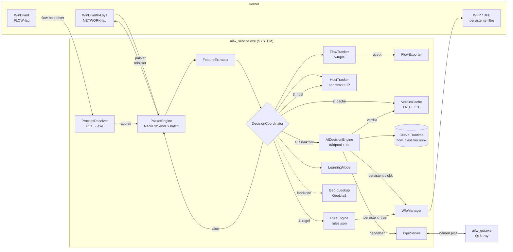

# AI-Firewall – KI-basert brannmur for Windows 11

> **Status: forsknings-/utviklingsprosjekt (v0.1).** Ikke sertifisert, ikke revidert, ikke
> ment som eneste beskyttelse av en produksjonsmaskin. Les [Viktige advarsler](#viktige-advarsler)
> og [docs/SECURITY.md](docs/SECURITY.md) før du kjører den.

AI-Firewall fanger nettverkstrafikk med **WinDivert**, bygger statistikk per flyt (5-tuple),
lar en **ONNX-modell** vurdere flyten **asynkront**, og håndhever eksplisitte regler fra
`rules.json`. Regler som skal overleve omstart legges inn i **Windows Filtering Platform (WFP)**.
Et **Qt 6**-ikon i system tray viser blokkeringer, logg og lar deg slå læringsmodus av/på.

| Komponent | Teknologi | Fil(er) |
|---|---|---|
| Pakkeavskjæring | WinDivert 2.2 (signert driver + user-mode API) | `src/core/PacketEngine.*` |
| Prosess/app per flyt | WinDivert FLOW-lag | `src/core/ProcessResolver.*` |
| Persistente regler | WFP (`FwpmEngineOpen0`, egen provider/sublayer, `FwpmFilterAdd0`) | `src/core/WfpManager.*` |
| Flytsporing | 5-tuple-tabell, tidsavbrudd, Welford-statistikk | `src/core/FlowTracker.*` |
| Vertsnivå-deteksjon | Sliding window per remote-IP (unike porter, nye flyter, SYN) | `src/core/HostTracker.*` |
| Flyt-eksport | Anonymisert JSONL av utløpte flyter for ML-trening | `src/core/FlowExporter.*` |
| GeoIP | MaxMind GeoLite2 via libmaxminddb (valgfri) | `src/core/GeoIpLookup.*` |
| Features | Egen IPv4/IPv6/TCP/UDP-parser + `WinDivertHelperParsePacket`, Shannon-entropi | `src/core/FeatureExtractor.*`, `Entropy.*` |
| KI-inferens | ONNX Runtime, trådpool, batching, terskler, circuit breaker | `src/core/AIDecisionEngine.*`, `OnnxModel.cpp` |
| Regelmotor | JSON-regler: app, port(-område), IP/CIDR (v4/v6), retning, protokoll | `src/core/RuleEngine.*` |
| Beslutning | Regel → cache → host → standard + asynkron AI, læringsmodus, fail-safe | `src/core/DecisionCoordinator.*` |
| Læringsmodus | Registrerer trafikk, foreslår regler | `src/core/LearningMode.*` |
| Tjeneste | Windows-tjeneste, admin-sjekk, konsollmodus | `src/service/*` |
| IPC | Named pipe `\\.\pipe\aifw`, JSON Lines | `src/core/IpcProtocol.*`, `src/service/PipeServer.*` |
| GUI | Qt 6 system tray, varsler, logg, læringsbryter | `src/gui/*` |
| Logging | spdlog (konsoll + roterende fil) | `src/core/Log.*` |
| ML-pipeline | Python, scikit-learn → skl2onnx → verifisering | `ml/` |

## Arkitektur



**Pakkeveien venter aldri på AI.** For hver pakke:

1. **Regel** (`RuleEngine`) – eksplisitte allow/deny vinner alltid.
2. **Cache** (`VerdictCache`) – tidligere AI- eller host-verdikt for flyten (TTL, LRU).
3. **Vertsnivå** (`HostTracker`) – på første pakke i ny flyt: for mange unike porter / nye flyter / SYN fra samme remote-IP → blokk.
4. **Standardverdikt** (normalt `allow`) – og *hvis flyten har nok pakker* legges en
   forespørsel i AI-køen. Svaret havner i cachen og gjelder fra neste pakke.
   Flyter re-evalueres hver `reevaluate_every_packets` pakke, så en flyt som endrer
   karakter (f.eks. går over i SYN-flom) fanges.
5. **Fail-safe**: Ved modellfeil åpnes en circuit breaker (etter `max_consecutive_errors`)
   og bare regler + standard brukes til modellen svarer igjen. Full kø → ingen AI-vurdering
   for den pakken (heller det enn å blokkere nettverket).

Ved blokkering kan PacketEngine injisere **TCP RST** eller **ICMP unreachable** (konfigurerbart) slik at appen får rask feil i stedet for timeout.

Når `geoip.enabled` er `true` og en GeoLite2-Country `.mmdb` ligger på angitt sti, berikes blokkerings-hendelser med ISO-landkode.

Se [docs/ARCHITECTURE.md](docs/ARCHITECTURE.md) for detaljer om tråder, eierskap og dataflyt.

## Mappestruktur

```
ai-firewall/
├── CMakeLists.txt, CMakePresets.json, vcpkg.json, cmake/   Byggesystem
├── src/core/        Kjerne (plattformuavhengig + Windows-deler bak #ifdef _WIN32)
├── src/service/     Windows-tjeneste, named pipe-server, WFP-kobling
├── src/gui/         Qt 6 system tray-app
├── src/tools/       aifw_sim – trafikk-simulator (kjører også på Linux)
├── tests/           GoogleTest-enhetstester
├── ml/              Python: skjema, datasett, trening, ONNX-eksport, verifisering
├── models/          plasseres flow_classifier.onnx her (genereres med `python -m aifw_ml.train`)
├── config/          config.json og rules.json (eksempler)
├── scripts/         setup-windows.ps1
└── docs/            ARCHITECTURE.md, SECURITY.md
```

## Bygg på Windows 11 (Visual Studio 2022 + vcpkg)

### Forutsetninger
- Windows 11 x64, administratorrettigheter
- Visual Studio 2022 (17.8+) med arbeidsbelastningen **"Desktop development with C++"**
- CMake 3.24+ (følger med VS) og Git
- vcpkg:
  ```powershell
  git clone https://github.com/microsoft/vcpkg C:\vcpkg
  C:\vcpkg\bootstrap-vcpkg.bat
  setx VCPKG_ROOT C:\vcpkg
  ```
- WinDivert 2.2.2: last ned `WinDivert-2.2.2-A.zip` fra
  <https://github.com/basil00/WinDivert/releases> og pakk ut, f.eks. til `C:\libs\WinDivert-2.2.2-A`.

### Bygg (automatisk)
Åpne **Developer PowerShell for VS 2022** i prosjektmappen:
```powershell
powershell -ExecutionPolicy Bypass -File scripts\setup-windows.ps1
```

### Bygg (manuelt)
```powershell
$env:WINDIVERT_DIR = "C:\libs\WinDivert-2.2.2-A"
cmake --preset windows-vcpkg          # vcpkg henter spdlog, nlohmann-json, gtest, onnxruntime, qtbase
cmake --build --preset windows-release
ctest --preset windows-release
```
Første gang tar vcpkg tid (Qt og ONNX Runtime bygges/lastes ned). Alternativer:
- **ONNX Runtime fra offisiell zip** i stedet for vcpkg: last ned `onnxruntime-win-x64-<ver>.zip`,
  sett `$env:ONNXRUNTIME_DIR` og bruk presetet `windows-manual-onnx`.
- **Uten GUI**: `-DAIFW_BUILD_GUI=OFF`. **Uten ONNX** (kun heuristikk + regler): `-DAIFW_WITH_ONNX=OFF`.
- **Uten GeoIP**: `-DAIFW_WITH_GEOIP=OFF`.

CMake-valg: `AIFW_BUILD_TESTS`, `AIFW_BUILD_TOOLS`, `AIFW_BUILD_SERVICE`, `AIFW_BUILD_GUI`,
`AIFW_WITH_ONNX`, `AIFW_WITH_GEOIP`, `AIFW_FETCH_DEPS`, `AIFW_WARNINGS_AS_ERRORS`, `WINDIVERT_DIR`, `ONNXRUNTIME_DIR`.

### WinDivert-oppsett
- `WinDivert.dll` **og** `WinDivert64.sys` må ligge ved siden av `aifw_service.exe`
  (CMake kopierer dem automatisk etter bygging).
- Driveren lastes automatisk første gang `WinDivertOpen` kalles – **krever administrator**.
- Kontroller signaturen: `Get-AuthenticodeSignature .\WinDivert64.sys`.
- Noen antivirus/EDR-produkter blokkerer WinDivert (den brukes også av skadevare). Feilkode
  `ERROR_DRIVER_BLOCKED` (1275) eller `ERROR_INVALID_IMAGE_HASH` (577) betyr at driveren er stoppet.
- Med *Memory integrity* (HVCI) på må driveren være kompatibel – WinDivert 2.2 er det, men
  test på din maskin.

### Kjør
```powershell
# Som administrator, fra build\windows-vcpkg\Release (config\ og models\ kopieres av skriptet):
.\aifw_service.exe --console        # forgrunn, Ctrl+C stopper – start her!
.\aifw_service.exe --install        # registrer tjenesten "AiFirewall" (automatisk oppstart)
sc start AiFirewall
.\aifw_gui.exe                      # system tray (vanlig bruker; endringer krever admin)
.\aifw_service.exe --uninstall      # fjern tjenesten
.\aifw_service.exe --wfp-cleanup    # fjern alle persistente WFP-filtre fra AI-Firewall
```
Standard `config.json` starter i **læringsmodus** (AI blokkerer ingenting, regler gjelder).
Slå av læringsmodus i GUI-et (som administrator) eller sett `"learning_mode": false` når du
har gått gjennom loggen og regelforslagene.

### Uten Windows: simulator
`aifw_sim` kjører samme kjede (parser → flyt → regel/cache/AI) på syntetiske pakker:
```bash
cmake --preset linux-core && cmake --build --preset linux-core && ctest --preset linux-core
./build/linux-core/aifw_sim --base .            # (+ --learning for regelforslag)
```

## Modelltrening (ml/)

```bash
cd ml
python -m venv .venv && . .venv/bin/activate     # Windows: .venv\Scripts\activate
pip install -r requirements.txt
python -m aifw_ml.train                          # syntetiske data -> out/flow_classifier.onnx
python -m aifw_ml.verify_onnx                    # sjekker skjema, avvik mot sklearn, latens
cp out/flow_classifier.onnx ../models/
```
- **Feature-skjema**: `ml/feature_schema.json` er eneste kilde til sannhet. C++ har samme
  liste i `src/core/FeatureSchema.hpp`; testen `FeatureSchema.MatchesPythonSchema` feiler hvis
  de spriker. `ml/aifw_ml/features.py` er en eksakt Python-kopi av C++-beregningen.
- **Syntetiske data** (`aifw_ml/synthetic.py`): surfing, DNS, video, SSH, VoIP, nedlasting, NTP
  mot SYN-flom, avviste SYN-forsøk, UDP-flom, høy-entropi-exfiltrering, C2-beaconing og
  slowloris. Rader lages ved samme pakkeantall som C++ kjører inferens (4, 68, 132, …).
  Disse dataene er *lette* – modellen får nær perfekte tall på dem. Det sier **ingenting** om
  reell treffsikkerhet.
- **CIC-IDS2017** (`aifw_ml/cicids2017.py`): `python -m aifw_ml.train --cicids "D:\MachineLearningCVE\*.csv" --mix-synthetic`.
  Les modulens docstring om forskjellene (payload- vs. IP-lengde, manglende entropi/protokoll,
  kjente feil i datasettet).
- **Modellvalg**: Random Forest (standard, robust, ingen skalering) eller `--model mlp`.
- **Output** som C++ forventer: input `features` float32 `[N,20]`, output `probabilities`
  `[N,2]` (eksporter med `zipmap=False`), kolonne 1 = P(ondsinnet).
- Juster `ai.block_threshold` ut fra `false_positive_rate_at_block` i `out/metrics.json`.

`models/flow_classifier.onnx` er ikke committet i repoet; den regenereres med `python -m aifw_ml.train` (deretter `cp out/flow_classifier.onnx ../models/`). Det er en **demomodell trent på syntetiske data**. Tren din egen før du slår av læringsmodus.

Utløpte flyter eksporteres anonymisert til `data/flows_export.jsonl` og kan brukes til å trene en bedre modell på din egen trafikk.

## Konfigurasjon

- `config/config.json`: terskler, køer, tidsavbrudd, WinDivert-filter, WFP, logg, GeoIP.
  Alle stier er relative til mappen med `aifw_service.exe`. Kommentarer (`//`) er tillatt.
- `config/rules.json`: regler. Høyest `priority` vinner; ved lik prioritet vinner `deny`.
  ```json
  {"id": "deny-telnet", "action": "deny", "protocol": "tcp", "remote_ports": [23, "2300-2400"],
   "remote_ips": ["0.0.0.0/0"], "direction": "out", "priority": 90, "persistent": true}
  ```
  `app` kan være full sti, bare filnavn, eller wildcard (`*`, `?`), uten hensyn til store/små bokstaver.
  `persistent: true` legger regelen inn i WFP (krever full app-sti uten wildcard).

### GeoIP
Sett `geoip.enabled` til `true` og legg en `GeoLite2-Country.mmdb` (eller City) i `data/`.
Databasen kan lastes ned fra MaxMind (krever gratis konto) eller fra uoffisielle speil som
[FyraLabs/geolite2](https://github.com/FyraLabs/geolite2). Husk GeoLite2 EULA (attribusjon + jevnlig oppdatering).

## Viktige advarsler

1. **Kjør som administrator.** Pakkeavskjæring og WFP krever det. Tjenesten kjører som SYSTEM.
2. **WinDivert-driveren må være til stede** (`WinDivert.dll` + `WinDivert64.sys`, signert).
3. **Falske positive.** En AI-modell *vil* blokkere legitim trafikk av og til. Start i
   læringsmodus, les loggen, juster terskler og legg inn allow-regler for det du stoler på.
4. **Fail-open.** Stopper eller krasjer tjenesten, slipper WinDivert-trafikken uhindret
   gjennom (persistente WFP-regler gjelder fortsatt). Det er bevisst, for ikke å låse deg ute.
5. **Lås deg ikke ute.** Test på en maskin du har fysisk tilgang til / VM. Fjern persistente
   regler med `--wfp-cleanup` hvis noe går galt.
6. **Ytelse er ikke målt på ekte maskinvare.** Batching, køer og trådtall er satt konservativt;
   mål gjennomstrømning og latens på din maskin.
7. **Ikke produksjonssertifisert.** Ingen sikkerhetsrevisjon, ingen fuzzing av parseren utover
   enhetstestene, ingen signert installasjonspakke. Bruk Windows Defender Firewall i tillegg.
8. **Personvern.** Loggene inneholder IP-adresser og app-stier. Se docs/SECURITY.md.

## Hva er testet

| Del | Status |
|---|---|
| Kjerne (parser, flyt, entropi, regler, cache, AI-motor, koordinator, læring, konfig, IPC) | 62 GoogleTest-tester (65 med ONNX), kjørt på Linux (clang 22, libc++), 0 advarsler |
| Python- og C++-features gir samme verdier | `FeatureParity`-test mot fixture fra `ml/aifw_ml/export_parity_fixture.py` |
| `OnnxModel` mot ekte ONNX Runtime 1.22 og modellen fra `ml/` | Testet på Linux, likt sklearn innen 1e-5 |
| `aifw_sim` ende-til-ende | Kjørt på Linux med heuristikk og ONNX-modell |
| Windows-kode (PacketEngine, ProcessResolver, WfpManager, tjeneste, PipeServer) | **Kryss-kompilert og lenket** for x86_64-windows (MinGW/clang) mot ekte WinDivert 2.2.2 og ONNX Runtime 1.22 – **ikke kjørt** |
| Qt-GUI | Kompilert mot Qt 6.8-headere med moc – **ikke kjørt** |
| MSVC-bygg, kjøring på Windows 11, WFP-filtre i praksis, ytelse | **Ikke verifisert** – må gjøres på Windows |

## Veikart

- [ ] Verifisere og profilere på Windows 11 (MSVC), inkl. stress-test (iperf3) og latensmåling
- [x] Vertsnivå-features (mange flyter fra samme kilde → portskanning, brute force)
- [x] TCP RST / ICMP unreachable ved blokkering (raskere feil for appen enn timeout) – grunnleggende IPv4-støtte
- [x] Eksport av ekte flyter fra tjenesten (anonymisert) for trening på egen trafikk
- [x] Modellversjonering + signert modellfil, hot-reload av modell (IPC `reload_model` med valgfri `path`; trådsikker bytte via `setModel`)
- [~] DNS-oppslag i loggen (domenenavn i stedet for IP), GeoIP (GeoIP-landkode lagt til; DNS gjenstår)
- [ ] Per-app-statistikk og "spør brukeren"-dialog for nye apper (interaktiv modus)
- [ ] WinUI 3-variant av GUI-et, MSIX/WiX-installer med signering
- [ ] Fuzzing av pakkeparseren (libFuzzer) og ETW-logging
- [ ] Gruppe-basert tilgang for GUI-kommandoer (i stedet for kun administrator)

## Lisens

Ingen lisens er valgt ennå. Merk at **WinDivert er dobbeltlisensiert LGPLv3 / GPLv2** – sjekk
vilkårene før distribusjon. ONNX Runtime er MIT, Qt er LGPLv3/kommersiell, spdlog og
nlohmann/json er MIT. GeoLite2-data er under MaxMind GeoLite2 EULA.
