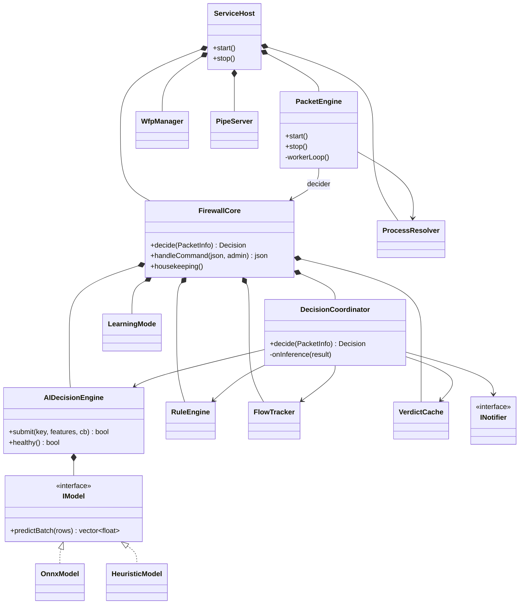
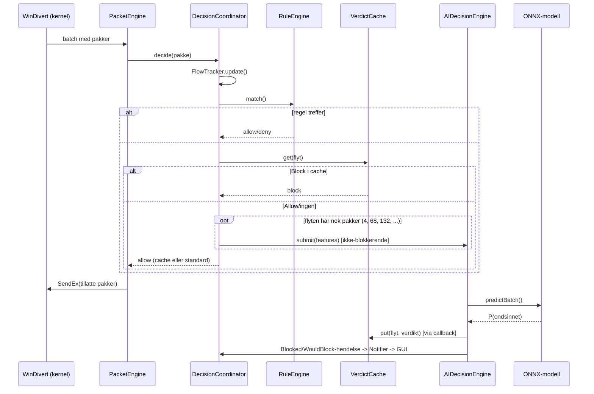

# Arkitektur

## Mål og prinsipper

| Prinsipp | Hvordan |
|---|---|
| Pakkeveien blokkeres aldri av AI | `DecisionCoordinator::decide()` gjør kun O(1)-oppslag (regel, cache) og *legger* AI-jobber i en begrenset kø. |
| Fail-safe | Modellfeil → circuit breaker → kun regler + standardverdikt. Full kø → ingen AI for den pakken. Unntak i `decide()` → pakken slippes gjennom. Tjenesten stopper → WinDivert-håndtaket lukkes og trafikk går fritt (WFP-regler gjelder fortsatt). |
| RAII overalt | Alle OS-ressurser har en eier med destruktør: `UniqueHandle`, WinDivert-håndtak i `PacketEngine`/`ProcessResolver`, WFP-engine og `Transaction` i `WfpManager`, `WfpMem` for WFP-minne, `std::jthread` for tråder. |
| Tydelig eierskap | `ServiceHost` eier alt via `std::unique_ptr`. Komponenter får *ikke-eiende* referanser til det de bruker, og medlemsrekkefølgen sikrer at brukere destrueres før det de bruker. |
| Separasjon av ansvar | Parsing, flytstatistikk, regler, AI, beslutning, persistens, IPC og GUI er egne klasser. Kjernen kjenner bare grensesnitt (`IModel`, `INotifier`, `IPersistentRuleSink`). |
| Testbarhet | Alt plattformuavhengig (≈ 80 % av logikken) bygges og testes på Linux. Windows-spesifikk kode ligger bak `#ifdef _WIN32` i egne filer. |

## Komponenter

## Tråder

| Tråd | Antall | Gjør | Blokkerer på |
|---|---|---|---|
| PacketEngine-arbeidere | `windivert.worker_threads` (2) | `WinDivertRecvEx` → parse → `decide()` → `WinDivertSendEx` | kernel-køen |
| ProcessResolver | 1 | leser FLOW-hendelser, slår opp exe-sti | kernel-køen |
| AI-arbeidere | `ai.worker_threads` (2) | batcher opptil `ai.max_batch` forespørsler, kjører modellen | `condition_variable_any` |
| Housekeeping | 1 | utløp av flyter (hvert 5. s), lagring av læringsdata (hvert min.) | timer |
| PipeServer accept | 1 | `ConnectNamedPipe` (overlapped) | hendelse |
| PipeServer klient | 1 per klient (maks 8) | leser kommandoer, svarer | overlapped I/O |
| PipeServer sender | 1 | sender push-hendelser til alle klienter | kø |

Delt tilstand og synkronisering:
- `FlowTracker`: 16 shards med hver sin `std::mutex` (lav konkurranse mellom pakketråder).
- `VerdictCache`: én mutex (korte kritiske seksjoner; LRU-liste + hash-map).
- `RuleEngine`: `std::shared_mutex` – mange lesere (pakketråder), sjelden skriving (reload).
- `AIDecisionEngine`: mutex + `condition_variable_any` med `std::stop_token`; tellere er atomiske.
- `DecisionCoordinator`: sett med "pending" flyter (mutex) så samme flyt ikke ligger i køen flere ganger.

## Beslutningsflyt per pakke

Konsekvens: de første pakkene i en ondsinnet flyt slipper gjennom før AI har svart (typisk
< 1 ms på CPU for en trebasert modell). Det er prisen for aldri å øke latensen på normal
trafikk. Eksplisitte regler og persistente WFP-regler gjelder fra første pakke.

## Features

20 features per flyt (se `ml/feature_schema.json`): varighet, pakker/bytes per retning,
pakkelengde (snitt/std), tid mellom pakker (snitt/std), TCP-flagg (SYN/FIN/RST/PSH),
snitt-entropi for payload (første 8 payload-pakker, maks 256 byte hver), normalisert
remote-port, protokoll (one-hot TCP/UDP), pakker/s, bytes/s og fwd/bwd-forhold.

Statistikken oppdateres inkrementelt (Welford), så minnebruk per flyt er konstant (~200 byte).

## Persistens

- **rules.json** er kilden til sannhet for regler. Lagring skjer atomisk (skriv `.tmp` + rename).
- **WFP**: ved oppstart synkroniseres alle regler med `persistent: true` (fjern alle våre
  filtre → legg inn på nytt). AI-blokkeringer (når `wfp.persist_ai_blocks` er på) skrives både
  til rules.json (`source: "ai"`) og WFP, så de overlever også en ny synk.
- WFP-filtre legges i egen **provider** og **sublayer** med faste GUID-er, i ALE-lagene
  (`ALE_AUTH_CONNECT` for utgående, `ALE_AUTH_RECV_ACCEPT` for innkommende, v4 og v6).
  ALE evalueres én gang per forbindelse og kan matche på app (`FWPM_CONDITION_ALE_APP_ID`).
- **Læringsdata** lagres i `data/learning.json`.

## IPC-protokoll

JSON Lines over `\\.\pipe\aifw` (se `src/core/IpcProtocol.hpp`):

| Kommando | Krever admin | Svar |
|---|---|---|
| `{"cmd":"ping"}` | nei | `ok` |
| `{"cmd":"get_status"}` | nei | tellere, AI-helse, læringsmodus |
| `{"cmd":"get_events"}` | nei | siste 500 hendelser |
| `{"cmd":"get_suggestions"}` | nei | foreslåtte regler |
| `{"cmd":"set_learning","enabled":true}` | **ja** | ny tilstand |
| `{"cmd":"apply_suggestions"}` | **ja** | antall regler lagt til |
| `{"cmd":"reload_rules"}` | **ja** | antall regler |

Push fra tjenesten: `{"type":"event","event":{"type":"blocked","flow":"...","app":"...","reason":"ai","score":0.97,...}}`.

## Utvidelsespunkter

- Ny modell-backend: implementer `IModel` (f.eks. DirectML/GPU via ONNX Runtime execution providers).
- Nye varslingskanaler: implementer `INotifier` (Windows toast, e-post, SIEM/syslog).
- Nye features: legg til i `FeatureSchema.hpp`, `feature_schema.json`, `features.py` og
  `FeatureExtractor::extract`, øk `kFeatureSchemaVersion`, tren modellen på nytt.
